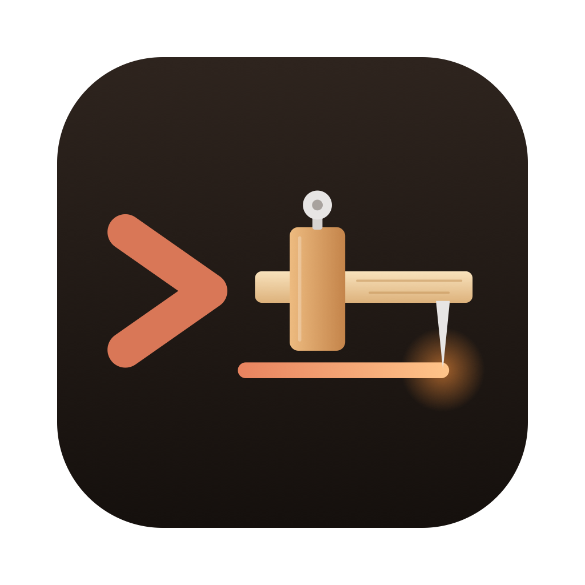

<div align="center">



# Trusquin

**Écrivez vos règles une fois. Trusquin les range au bon endroit pour Claude Code.**


[](LICENSE)


[English](README.md) · **Français**

</div>

Trusquin est une application de bureau gratuite pour les développeurs qui utilisent [Claude Code](https://claude.com/claude-code), l'assistant de programmation d'Anthropic. Vous décrivez vos consignes en langage courant, Trusquin génère les bons fichiers (`CLAUDE.md`, règles, skills, agents, hooks…), les place au bon endroit, vérifie leur qualité et note vos dépôts existants.

## 📸 Aperçu

<!-- TODO : ajouter une capture, par exemple  -->

> 💡 _Le trusquin est l’outil du charpentier qui trace, avant la coupe, où passera chaque ligne._

## ✨ Fonctionnalités

- 🧭 **Guide pas à pas** : un arbre de décision vous mène au bon élément Claude Code, avec des modèles prêts à l'emploi.
- 🛠️ **Générateur** : règles, skills, slash commands, sous-agents, hooks et permissions, avec la destination de chaque fichier affichée en direct.
- ✅ **Contrôle qualité** : score sur 100, détection des secrets, consignes floues, doublons et contradictions ; les erreurs bloquent l'export.
- 📊 **Analyse de dépôt** : note de A à E pour un projet existant, points à corriger, évolution du score et import des règles.
- 📦 **Export** : écriture directe dans le projet ou archive zip.
- 🌍 **Français et anglais** : l'interface suit la langue du système (modifiable dans les réglages) ; les fichiers générés restent en français.
- 🔒 **100 % local** : aucun compte, aucun envoi réseau, vos données restent dans une base SQLite sur votre machine.

## 🚀 Installation

Téléchargez le fichier de votre système sur la page [Releases](https://github.com/despresnicolas/trusquin/releases) :

| Système                                          | Fichier                                                   |
| ------------------------------------------------ | --------------------------------------------------------- |
| macOS 12+ (Apple Silicon et Intel)               | `trusquin-macos-universal.zip`                            |
| Windows 11 (x64)                                 | `trusquin-amd64-installer.exe`                            |
| Ubuntu 24.04+, Pop!\_OS 24.04+, Debian 13+ (x64) | `.deb` (`sudo apt install ./trusquin.deb`) ou `.AppImage` |

> ⚠️ Trusquin n'est pas encore signé par Apple ni par Microsoft : votre système vous avertit au premier lancement.
> **macOS** : si l'app est refusée, ouvrez Réglages Système → Confidentialité et sécurité et cliquez sur **Ouvrir quand même**.
> **Windows** : sur « Windows a protégé votre ordinateur », cliquez sur **Informations complémentaires → Exécuter quand même**.

### Compiler depuis les sources

**Prérequis :** [Go](https://go.dev/dl/) 1.26+, [Node.js](https://nodejs.org/), [pnpm](https://pnpm.io/installation).

```bash
# 1. CLI Wails 3
go install github.com/wailsapp/wails/v3/cmd/wails3@latest
wails3 doctor

# 2. Récupérer et compiler Trusquin
git clone https://github.com/despresnicolas/trusquin.git
cd trusquin
pnpm install
wails3 build       # binaire dans bin/trusquin
wails3 package     # application empaquetée (.app, installeur…)
```

## 🎯 Utilisation

1. 📝 **Générateur** : renseignez le nom et la stack du projet.
2. ➕ Ajoutez vos règles, chacune avec sa portée (tout le projet, un dossier, certains fichiers…).
3. 👀 **Aperçu & export** : relisez les fichiers générés et corrigez les points signalés.
4. 💾 Exportez dans votre projet ou en zip.

Projet déjà configuré ? Ouvrez **Analyse de dépôt**, choisissez le dossier et importez ses règles pour les retravailler.

| Vous écrivez…                           | Trusquin génère…                       |
| --------------------------------------- | -------------------------------------- |
| Une règle pour tout le projet           | `CLAUDE.md`                            |
| Une règle pour les fichiers `*.test.ts` | `.claude/rules/<nom>.md` avec `paths:` |
| Une procédure à lancer à la demande     | `.claude/skills/<nom>/SKILL.md`        |
| Un contrôle automatique                 | `.claude/settings.json` (hook)         |

📖 Placement complet, barème qualité, critères d'analyse et emplacement des données : [docs/how-it-works.fr.md](docs/how-it-works.fr.md).

## 🗺️ Feuille de route

- [x] Binaires précompilés pour macOS, Windows et Linux
- [ ] App macOS signée et notarisée, installeur Windows signé
- [ ] Captures d'écran et démo animée

## 🤝 Contribuer

Les contributions sont bienvenues ! Signalez un bug ou proposez une idée dans les [issues](https://github.com/despresnicolas/trusquin/issues).

Trusquin est une application [Wails 3](https://v3.wails.io/) : Go pour l'accès disque et la base, SvelteKit (Svelte 5, TypeScript) pour l'interface et toute la logique métier.

```bash
wails3 dev         # mode développement, rechargement du Go et du front
pnpm test          # tests du cœur (Vitest) puis des services Go
pnpm check         # types Svelte + TS
pnpm lint          # ESLint
```

| Dossier              | Rôle                                                               |
| -------------------- | ------------------------------------------------------------------ |
| `main.go`, `menu.go` | application Wails : fenêtre, menu, front embarqué                  |
| `repo.go`            | `RepoService` : lecture d'un dossier local, écriture des exports   |
| `history.go`         | `HistoryService` : historique des analyses et des projets (SQLite) |
| `src/lib/core/`      | logique pure (placement, qualité, analyse), testée par Vitest      |
| `src/routes/`        | une route par onglet (SPA)                                         |
| `src/lib/bindings/`  | bindings TS générés par wails3, à ne pas éditer                    |

Les choix d'architecture sont consignés dans [`docs/adr/`](docs/adr/).

## 📄 Licence

Distribué sous licence [MIT](LICENSE).

Trusquin est un projet indépendant, sans lien avec Anthropic.
