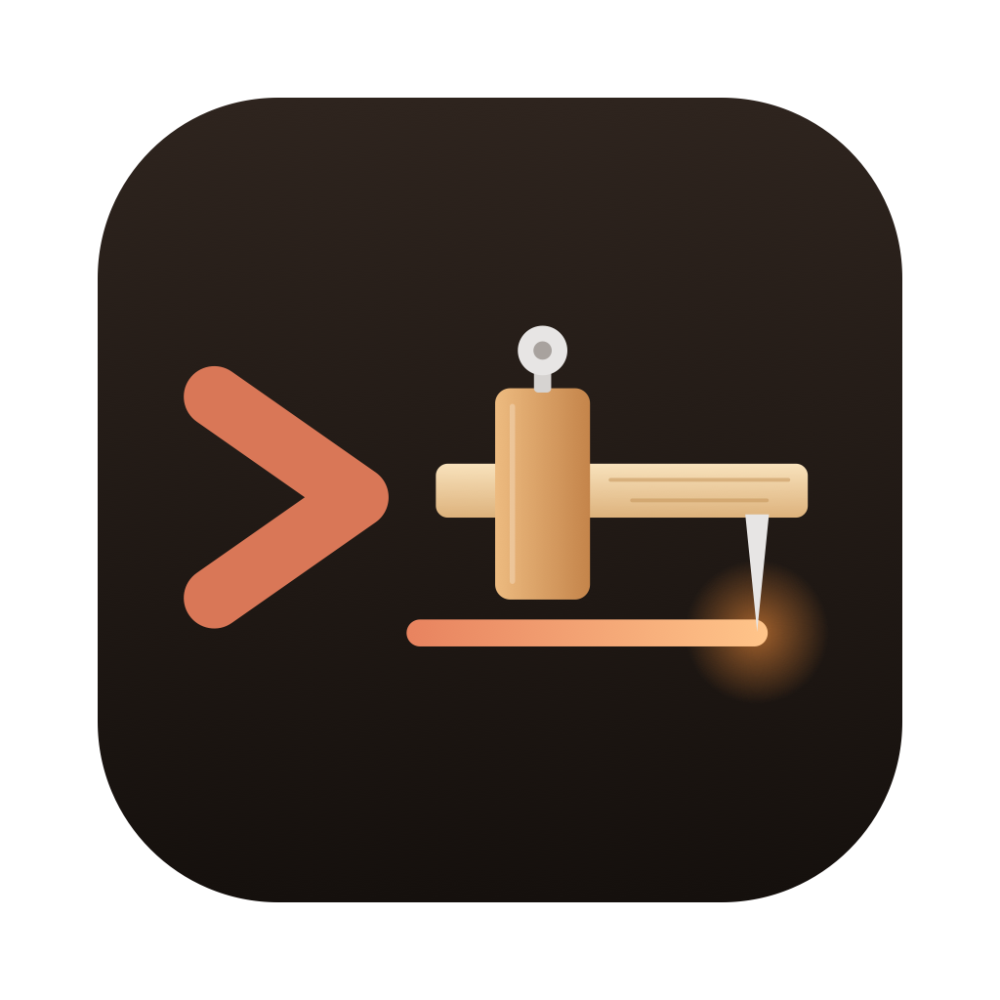

<div align="center">



# Trusquin

**Write your rules once. Trusquin puts them in the right place for Claude Code.**


[](LICENSE)


**English** · [Français](README.fr.md)

</div>

Trusquin is a free desktop app for developers who use [Claude Code](https://claude.com/claude-code), Anthropic's coding assistant. Describe your guidelines in plain language: Trusquin generates the right files (`CLAUDE.md`, rules, skills, agents, hooks…), puts them in the right place, checks their quality and scores your existing repositories.

## 📸 Preview

<!-- TODO: add a screenshot, e.g.  -->

> 💡 _A trusquin (marking gauge) is the carpenter's tool that marks, before the cut, where each line will go._

## ✨ Features

- 🧭 **Step-by-step guide**: a decision tree leads you to the right Claude Code item, with ready-to-use templates.
- 🛠️ **Generator**: rules, skills, slash commands, subagents, hooks and permissions, with each file's destination shown live.
- ✅ **Quality check**: score out of 100, detection of secrets, vague wording, duplicates and contradictions; errors block the export.
- 📊 **Repository analysis**: an A to E grade for an existing project, issues to fix, score history and rule import.
- 📦 **Export**: write straight into the project or to a zip archive.
- 🌍 **English and French**: the interface follows the system language (changeable in Settings); generated files stay in French.
- 🔒 **100% local**: no account, no network calls, your data stays in a SQLite database on your machine.

## 🚀 Quick start

> ℹ️ No prebuilt release is published yet: build the app from source.

**Requirements:** [Go](https://go.dev/dl/) 1.26+, [Node.js](https://nodejs.org/), [pnpm](https://pnpm.io/installation).

```bash
# 1. Wails 3 CLI
go install github.com/wailsapp/wails/v3/cmd/wails3@latest
wails3 doctor

# 2. Get and build Trusquin
git clone https://github.com/despresnicolas/trusquin.git
cd trusquin
pnpm install
wails3 build       # binary in bin/trusquin
wails3 package     # packaged app (.app, installer…)
```

## 🎯 Usage

1. 📝 **Generator**: enter the project's name and stack.
2. ➕ Add your rules, each with its scope (whole project, a folder, some files…).
3. 👀 **Check and export**: review the generated files and fix the reported issues.
4. 💾 Export into your project or to a zip.

Project already set up? Open **Analyze a repository**, pick the folder and import its rules to rework them.

| You write…                   | Trusquin generates…                     |
| ---------------------------- | --------------------------------------- |
| A rule for the whole project | `CLAUDE.md`                             |
| A rule for `*.test.ts` files | `.claude/rules/<name>.md` with `paths:` |
| A procedure to run on demand | `.claude/skills/<name>/SKILL.md`        |
| An automatic check           | `.claude/settings.json` (hook)          |

📖 Full placement, quality scale, analysis criteria and data location: [docs/how-it-works.md](docs/how-it-works.md).

## 🗺️ Roadmap

- [ ] Prebuilt binaries for macOS, Windows and Linux
- [ ] Screenshots and animated demo

## 🤝 Contributing

Contributions are welcome! Report a bug or suggest an idea in the [issues](https://github.com/despresnicolas/trusquin/issues).

Trusquin is a [Wails 3](https://v3.wails.io/) app: Go for disk access and the database, SvelteKit (Svelte 5, TypeScript) for the interface and all the business logic.

```bash
wails3 dev         # development mode, reloads Go and front end
pnpm test          # core tests (Vitest), then Go services
pnpm check         # Svelte + TS types
pnpm lint          # ESLint
```

| Folder               | Role                                                        |
| -------------------- | ----------------------------------------------------------- |
| `main.go`, `menu.go` | Wails app: window, menu, embedded front end                 |
| `repo.go`            | `RepoService`: reads a local folder, writes exports         |
| `history.go`         | `HistoryService`: analysis and project history (SQLite)     |
| `src/lib/core/`      | pure logic (placement, quality, analysis), tested by Vitest |
| `src/routes/`        | one route per tab (SPA)                                     |
| `src/lib/bindings/`  | TS bindings generated by wails3, do not edit                |

Architecture decisions are recorded in [`docs/adr/`](docs/adr/) (in French).

## 📄 License

Distributed under the [MIT](LICENSE) license.

Trusquin is an independent project, not affiliated with Anthropic.
